## `~/about` 

**Hey, I'm Sharn.** I build the apps people carry in their pockets: Kotlin and Jetpack Compose first, Swift when it's an iPhone, and whatever the backend needs behind them.

- `▸ now` &nbsp;**[ReviewSpot](https://github.com/skaur16/ReviewSpot)**, a reviews app in Kotlin and Compose
- `▸ ios` &nbsp;**[TravelBuddy](https://github.com/skaur16/TravelBuddy)** and **[WeatherApp](https://github.com/skaur16/WeatherApp)**, Swift, REST APIs and data that sticks around
- `▸ web` &nbsp;**[eat-n-split](https://github.com/skaur16/eat-n-split)**, React, for settling who owes whom
- `▸ loves` &nbsp;clean screens, state that behaves, a problem solved end to end
- `▸ next` &nbsp;a co-op in Waterloo or remote, where the app matters to someone
- `▸ story` &nbsp;told in eight voice notes at **[skaur.dev](https://skaur.dev)**

 

## `~/projects`

  
  

## `~/stack`

  

## `~/activity`

  
  

  

